# CasiWorks Pro

**Parametric 3D CAD for mechanical parts, in the browser.** Sketch, model, assemble, draw, and check strength in one app, then drive all of it from scripts.

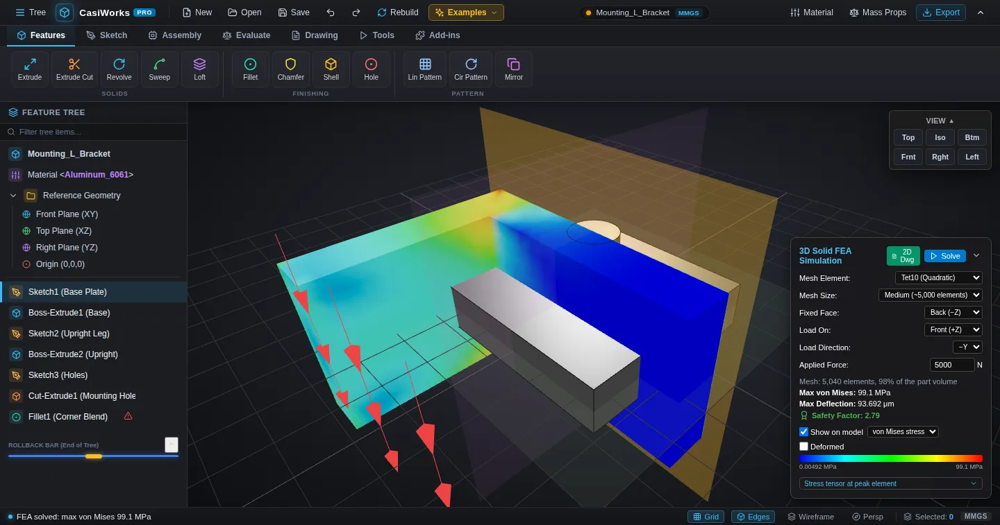

<p align="center">
  <b>TypeScript</b> · React 18 · three.js · Node 22.18+ &nbsp;|&nbsp; scripting API <b>1.19</b> · library REST API <b>v1</b> &nbsp;|&nbsp; <b>249</b> unit tests · <b>29</b> browser checks · performance budgets in CI
</p>

CasiWorks Pro is a parametric CAD application with a feature tree, a 2D constraint solver, assemblies with mates, 2D drawings with GD&T, stress and vibration analysis, and a local document library with versions and revisions. It runs entirely on your machine: the app is a static web page, and the optional library is a small Node server on `127.0.0.1`.

Solids are closed triangle meshes, not an exact B-Rep kernel. That choice keeps the app small and fast, and it sets some limits. See [Limits](#limits) for what that means in practice.

---

## Contents

- [Quick start](#quick-start)
- [Screenshots](#screenshots)
- [Features](#features)
- [Scripting and automation](#scripting-and-automation)
- [Document library and REST API](#document-library-and-rest-api)
- [Testing and quality](#testing-and-quality)
- [Project layout](#project-layout)
- [Configuration](#configuration)
- [Limits](#limits)
- [Documentation](#documentation)

---

## Quick start

You need **Node.js 22.18 or later** (it runs the TypeScript sources directly) and a current Chrome, Edge or Firefox.

```bash
npm install
npm run dev            # http://localhost:5173
```

The app opens with a starter block. Click **Examples** in the top bar to load one of eight example parts: an L-bracket, an M12 hex bolt, a pillow block, a piston, a pipe flange, a sheet-metal U-channel, a spur gear blank and a connecting rod.

| Command | What it does |
|---|---|
| `npm run dev` | Development server with hot reload |
| `npm run build` | Production build in `dist/` |
| `npm run server` | The built app plus the document library and REST API on `127.0.0.1:5180` |
| `npm test` | Unit tests (Node test runner, no browser) |
| `npm run e2e` | Browser checks against the built app (needs Chrome) |
| `npm run perf` | Bundle size, rebuild and solver timings against `perf-budgets.json` |
| `npm run lint` · `npm run typecheck` | ESLint and TypeScript |

---

## Screenshots

<table>
  <tr>
    <td width="50%">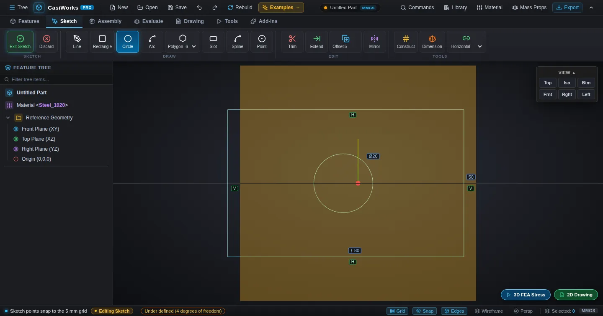<br><sub><b>Sketching.</b> Driving dimensions (one linked to a variable) and relation tags; the status bar reports how fully the sketch is defined.</sub></td>
    <td width="50%">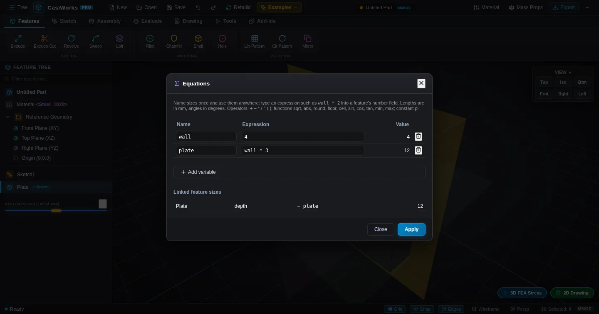<br><sub><b>Equations.</b> Named variables drive feature sizes and sketch dimensions; configurations switch between sets of values.</sub></td>
  </tr>
  <tr>
    <td>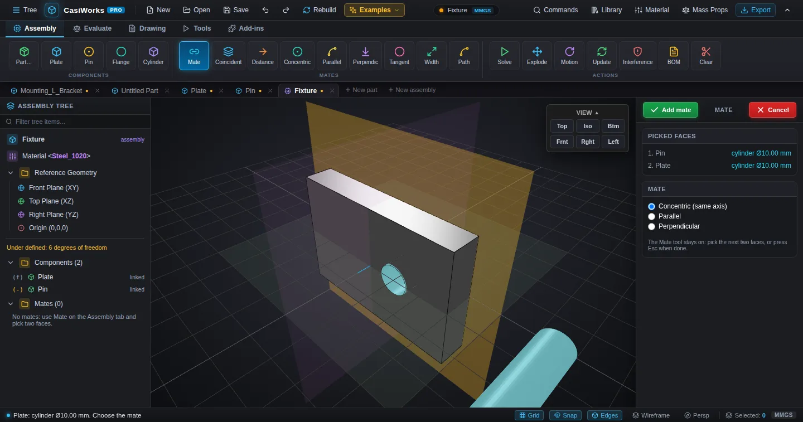<br><sub><b>Assemblies.</b> Click two real faces and the panel offers the mates that fit; here two Ø10 cylinders, concentric first.</sub></td>
    <td>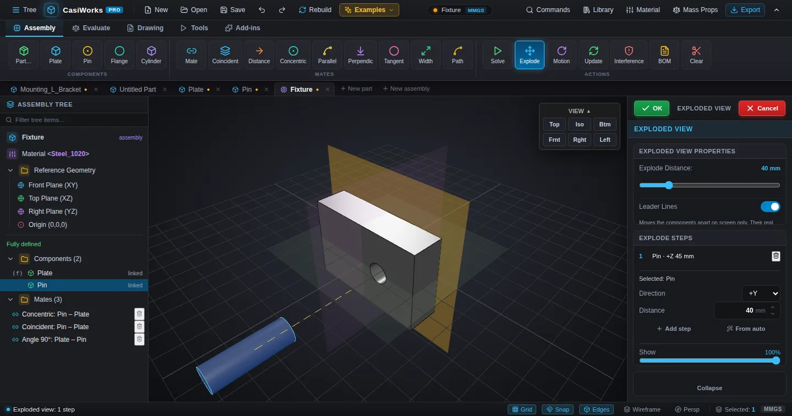<br><sub><b>Explode steps.</b> Components moved in steps along a direction, played in order, with leader lines.</sub></td>
  </tr>
  <tr>
    <td>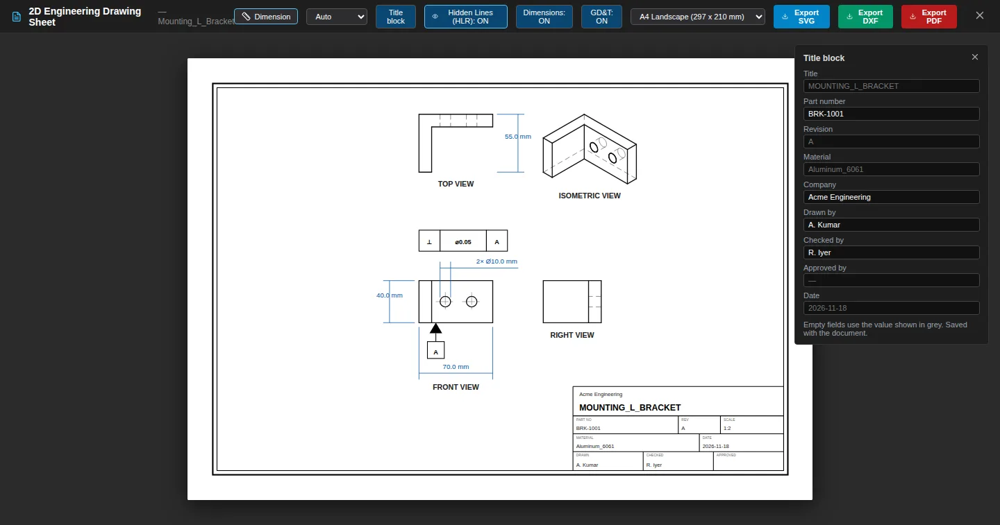<br><sub><b>Drawings.</b> Front, top, right and isometric views with hidden lines, true circles, dimensions, GD&T and an editable title block.</sub></td>
    <td>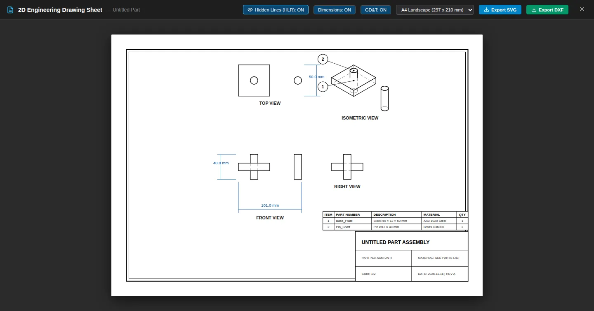<br><sub><b>Assembly drawings.</b> A parts list matching the bill of materials, with numbered balloons.</sub></td>
  </tr>
  <tr>
    <td>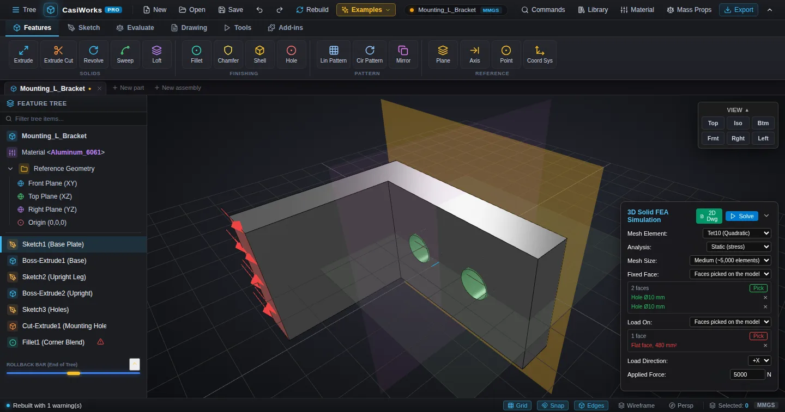<br><sub><b>Stress analysis setup.</b> The bracket held by its two bolt holes (green) and loaded on the end of the upright (red arrows).</sub></td>
    <td>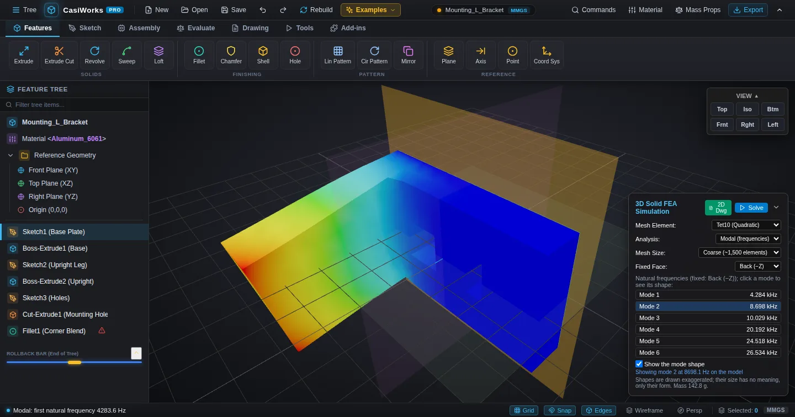<br><sub><b>Modal analysis.</b> The six lowest natural frequencies, and the shape of the chosen mode.</sub></td>
  </tr>
  <tr>
    <td>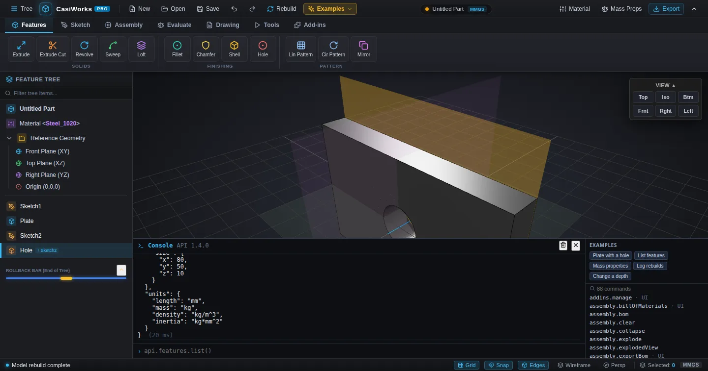<br><sub><b>Scripting console.</b> The full API in scope, with examples and a searchable list of commands.</sub></td>
    <td>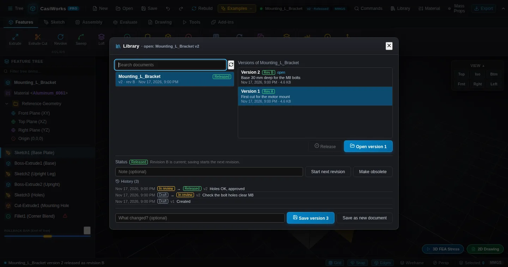<br><sub><b>Document library.</b> Every saved version kept, released revisions, review status and its history.</sub></td>
  </tr>
</table>

All screenshots are taken from the real app by `scripts/tutorial-shots.ts` (`npm run build && npm run docs:tutorial-shots`).

---

## Features

### Sketching

- Lines, corner rectangles, centre circles and arcs, polygons (3–64 sides), straight slots, splines and points, with construction geometry.
- Sketch on the Front, Top or Right plane, on a flat face of the part, or on a reference plane moved and tilted from a standard one.
- Edit tools: **Trim**, **Extend**, **Offset** (whole chains, corners rejoined) and **Mirror**.
- **Relations** (horizontal, vertical, parallel, perpendicular, equal, coincident, concentric, tangent, fix) and **driving dimensions** (length, distance, diameter, radius), solved by a Levenberg–Marquardt solver with QR-based rank analysis. The status bar shows under-, fully or over-defined, and conflicting relations are refused with a reason.

### Part modelling

- **Extrude** and **Extrude Cut** (blind, mid-plane, through all, thin), **Revolve** about a centreline, a sketch axis or a reference axis, **Sweep** and **Loft**.
- **Hole Wizard** with ISO metric sizes M3–M20: clearance (close, normal, loose), counterbore (ISO 4762), countersink (ISO 10642) and tapped holes.
- **Linear and circular patterns**, **mirror**, and reference **planes, axes, points and coordinate systems**.
- A **feature tree** with rollback, suppression (cascading to children), editing of any feature, and rebuild warnings on the feature that failed.
- **Equations and configurations**: variables such as `wall = 4` drive any size, including hole positions and sketch dimensions; a design table holds named versions of the part.
- **Undo and redo** for every change, **autosave** of every open document, and project files that keep the full history.

### Evaluate

- A library of 16 materials (steels, aluminium alloys, titanium, copper, brass, cast iron, plastics, carbon fibre, glass, wood, rubber) with density, stiffness and yield strength.
- **Mass properties**: mass, volume, surface area, centre of mass and inertia, exact for the mesh, optionally reported in your own coordinate system.
- **Measure**: distance, its X/Y/Z parts, the angle between faces, and the gap between parallel faces.
- **Unit systems** per document: MMGS, CGS, MKS and IPS. Every length field takes a unit (`25.4 mm`, `1"`, `2 ft`); files and the API stay in millimetres.

### Assemblies

- Parts and assemblies are separate documents, open side by side in tabs, each with its own undo history.
- Components refer to real part documents (open in the app, or in the library, pinned to a version or following the newest). When a part changes, the assembly follows.
- **Mates on real faces**: flat faces and cylinders are recognised from the mesh. Coincident, distance, concentric, parallel, perpendicular, angle, tangent, width and path.
- **Degrees of freedom** per component (fixed, under-defined with the motions left, over-defined with the conflicting mates), **motion** by driving a mate, **explode steps**, **interference detection** and a **bill of materials** with CSV export.

### Drawings

- Standard sheets **ISO A4–A0** and **ANSI A–D** with front, top, right and isometric views and hidden-line removal.
- Holes and arcs drawn as **true circles and arcs** with centre marks and hole callouts.
- Automatic dimensions, **datums and feature control frames** (ASME Y14.5 / ISO 1101), and **your own dimensions** that follow the model when it changes.
- An editable **title block** (company, part number, revision, material, drawn / checked / approved).
- **Assembly drawings** with a parts list and balloons.
- Export to vector **PDF** (true scale), **SVG** and **DXF**.

### Simulation

- **Linear static stress analysis** with Tet4 or quadratic Tet10 elements: von Mises stress, deflection and safety factor, plots on the model (also deformed), point probes, and a printable HTML report.
- **Modal analysis**: natural frequencies and mode shapes.
- **Supports and loads** on the outer sides of the part, or on **faces you pick**: flat faces and cylinders such as bolt holes, found again after the part changes.
- The mesh is fitted to the part. Grid lines run through every flat face that is square to an axis, so walls and sheet are meshed at their true thickness. Cells are halved across curved faces and graded between sizes.
- Solved in a Web Worker (the app stays responsive and a solve can be cancelled) with incomplete-Cholesky conjugate gradients, switching to a direct Cholesky solve when those converge slowly; the results say so if the solver ever stops before converging.
- Checked against closed-form results: a Tet10 cantilever matches beam theory within 3%, and thin plates in bending within 2%.

### Data exchange

| Format | Export | Open in the app | Notes |
|---|:-:|:-:|---|
| Project (`.casiproj`) | ✓ | ✓ | The only format with the editable history |
| STEP AP214 | ✓ | — | Faceted solid (flat triangles) |
| IGES 5.3 | ✓ | — | Manifold solid B-rep of triangles |
| STL (binary, ASCII) | ✓ | — | For 3D printing |
| OBJ | ✓ | — | Mesh with normals |
| DXF R12 | ✓ | — | Model as 3D faces; 2D sheets come from the drawing |

Exported files are checked against each standard's structure by parsers independent of the exporter. The kernel also has readers for STL, OBJ, DXF, faceted STEP and IGES 5.3, tested by round-tripping every example, but the app's **Open** command loads project files only.

---

## Scripting and automation

Every ribbon button, shortcut and status-bar toggle runs a **named command**, and a typed, versioned **public API** (currently **1.19**) drives the same model as the UI, so scripted changes appear in the feature tree and can be undone.

```js
// In the app: the console (Ctrl+`) has it as `api`; the browser console as window.casiworks
const { sketchId } = api.sketches.create({
  plane: 'Front',
  entities: [{ type: 'rectangle', corner1: { x: -30, y: -20 }, corner2: { x: 30, y: 20 } }],
});
const boss = api.features.extrude({ sketchId, depth: 25 });
api.features.update(boss, { depth: 40 });
api.model.massProperties();          // { volume: 96000 (mm³), mass, centerOfMass, … }
api.commands.execute('view.isometric');
```

- **Headless in Node**: `import { createHeadlessAPI } from 'casiworks-pro/api'` gives the same API with no browser, for part families, batch exports or design checks in CI.
- **Macros**: record model changes, replay them, or turn them into an editable script. A macro file is data and never runs code.
- **Add-ins**: an ES module can add commands and ribbon buttons through the public API. See the ISO 7089 washer generator in [`public/plugins/washer.js`](public/plugins/washer.js).
- **Events**: `rebuild`, `featureAdded`, `featureChanged`, `featureRemoved`, `selectionChanged`, `documentChanged`, `commandExecuted`.
- **Errors** are `CasiWorksAPIError` with a stable `code` (`INVALID_ARGUMENT`, `NOT_FOUND`, …). Units are mm, degrees and kg whatever the document's display units.

The full reference is generated from the source comments (`npm run docs:api`, also run before `dev` and `build`) and served with the app at **`/api/`** (Tools ▸ API Reference). A test fails if a public member is undocumented.

---

## Document library and REST API

```bash
npm run build && npm run server          # http://127.0.0.1:5180: the app plus /api/v1
npm run server -- key create "script"    # an API key for scripts (shown once)
```

A small Node server for one person on one machine. It listens on `127.0.0.1` only, keeps its data in `~/.casiworks`, and needs no extra packages (it uses the SQLite built into Node).

- **Versions and revisions**: every save is kept; releasing a version gives it the next revision letter (A, B, …). A save over a version someone saved after you opened it is refused rather than lost.
- **Status**: *Draft*, *In review*, *Released* or *Obsolete*, with a history of every change and its note. In review and obsolete documents are locked.
- **Where used**: which assemblies use each part, and which version.
- **REST API v1** (described at `/api/v1/openapi.json`): documents, versions, release, lifecycle, rebuild and export jobs (STL, OBJ, STEP, IGES, DXF without a browser), API keys and signed webhooks (`X-CasiWorks-Signature: sha256=…`).

```bash
curl -s -H "Authorization: Bearer $KEY" http://127.0.0.1:5180/api/v1/documents
```

In development, `npm run dev` proxies `/api/v1` to a running `npm run server`.

---

## Testing and quality

| Check | Command | What it covers |
|---|---|---|
| Unit tests | `npm test` | 249 tests over 45 files: kernel volumes against closed form, constraint solver, every mate, drawings, FEA against beam theory, data exchange round trips, API, commands, macros, add-ins, library server |
| Browser checks | `npm run e2e` | 29 flows in the real built app with Chrome: sketching with the mouse, features, assemblies, drawings, FEA with picked faces, units, export, macros, console, library |
| Performance budgets | `npm run perf` | Gzipped bundle, rebuild time of every example, a static and a modal solve, cold load; fails over `perf-budgets.json` |
| Static checks | `npm run lint` · `npm run typecheck` | ESLint with no warnings allowed; strict TypeScript |

CI (`.github/workflows/ci.yml`) runs all of these on Node 22 and 24.

---

## Project layout

```
src/
├── api/            Public scripting API (window.casiworks, casiworks-pro/api)
├── commands/       Command registry, built-in commands, macro recorder
├── kernel/         Mesh kernel: extrude, revolve, sweep, loft, CSG booleans, profiles,
│                   constraint solver, measure, materials, import and export
├── features/       Feature tree evaluation, equations, hole standards, coordinate systems
├── assembly/       Mates, face picking, degrees of freedom, explode steps, BOM, interference
├── drawings/       Projection and hidden lines, arcs, dimensions, title block, SVG / PDF / DXF
├── simulation/     FEA engine, fitted meshing, linear solvers, modal analysis, study setup, worker
├── workspace/      Part and assembly documents, references between them
├── library/        Client for the local document library
├── store/          Application state (Zustand + Immer), undo and redo
├── viewport/       3D view, picking and snapping, sketch tools
├── components/     Ribbon, feature tree, property panel, dialogs
├── console/        In-app scripting console
└── plugins/        Add-in manager
server/             Local library server: SQLite store, REST API, jobs, webhooks
scripts/            e2e checks, performance budgets, API docs, tutorial screenshots
tests/              Unit tests (node --test)
docs/tutorial/      The handbook, with its screenshots
```

---

## Configuration

Optional settings live in a `.env` file. `npm run server`, `npm run e2e`, `npm run perf` and `npm run docs:tutorial-shots` read it automatically.

```bash
cp .env.example .env
```

| Variable | Used by | Default |
|---|---|---|
| `CASIWORKS_DATA` | Library server: where documents and keys are kept | `~/.casiworks` |
| `PORT` | Library server port on `127.0.0.1` | `5180` |
| `CHROME_PATH` | Browser checks and screenshots, when Chrome is not in a standard place | found automatically |
| `E2E_ONLY` | Run only the browser checks whose name contains this text | all |

`.env` and every `.env.*` file are ignored by git; only the template `.env.example` is committed, so tokens kept in `.env` stay on your machine. An empty value counts as unset, and command-line flags (`--data`, `--port`) take precedence.

---

## Limits

These follow from the triangle-mesh kernel. An exact B-Rep kernel was evaluated and is not planned, so treat them as lasting and use the workarounds.

| Area | Today | Workaround |
|---|---|---|
| Fillet, chamfer, shell | Kept in the tree with a warning, not applied | Round corners with sketch arcs; hollow with an inward offset and a cut |
| Edges | Edges cannot be picked; faces can (flat faces and cylinders) | Use the neighbouring face |
| STEP and IGES | Faceted, not exact curved surfaces | Send a 2D drawing with machined parts |
| FEA supports | A support holds every direction; a face smaller than a mesh cell cannot be used | Use a finer mesh for small holes |
| Drawings | No section or detail views; automatic dimensions cannot be moved | Export DXF and finish in 2D CAD |
| Library | One person on one machine; no sharing or co-editing | By design |
| Language | The interface is in English | Translations are on the roadmap |

---

## Documentation

- **[The CasiWorks Pro Handbook](docs/tutorial/index.html)**: an 18-chapter hands-on course, from the first sketch to assemblies, drawings, FEA, scripting and the library, with worked examples and exercises.
- **API reference**: served by the app at `/api/` (Tools ▸ API Reference).
- **REST API**: `/api/v1/openapi.json` (OpenAPI 3.1) on a running library server.
- **[Roadmap](ROADMAP.md)**: what is done and what is open.
